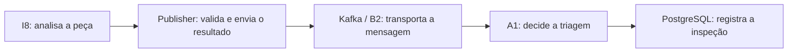

# Sprint 3 — O que a atividade 06 entrega

**O I8 ganhou a capacidade de enviar seu resultado ao Kafka e conferir se a
mensagem foi recebida.** Antes, o caminho de replay apenas gravava resultados
em arquivo; a biblioteca de publicação ainda não tinha conexão Kafka.

## Onde isso entra na arquitetura

O publisher é a saída do I8 para o barramento. Ele não analisa imagens nem decide
se a aplicação deve aprovar, rejeitar ou encaminhar uma peça para revisão. Essas
responsabilidades continuam, respectivamente, no processamento I8 e no A1.

## Por que escolhemos esse comportamento

| Decisão | Importância para o projeto |
|---|---|
| Usar o contrato 2.0 | I8 e A1 entendem os mesmos campos e resultados. |
| Enviar pelo Kafka | I8 entrega ao barramento; não precisa acessar o banco ou os módulos internos do A1. |
| Esperar a confirmação do Kafka | O I8 distingue envio confirmado de uma mensagem apenas colocada na fila local. Isso ainda não confirma processamento no A1. |
| Reenviar com o mesmo identificador | Se houver dúvida na entrega, o A1 consegue reconhecer uma mensagem repetida e evitar uma segunda inspeção. |
| Separar captura, análise e publicação | Permite acompanhar quando cada etapa aconteceu e investigar atrasos sem confundir os horários. |
| Configurar o endereço do Kafka | Permite trocar o laboratório pelo ambiente compartilhado sem reescrever o processamento da imagem. |

“Replay” significa executar novamente uma sequência de imagens/detecções
gravadas. A opção `--kafka` conecta esse caminho de inferência ao novo envio.
Sem a opção, ele continua funcionando localmente como antes. Também existe um
comando para reenviar mensagens já gravadas, sem repetir a análise nem trocar
seus identificadores.

## O que foi comprovado e o que falta

Passaram **141 testes**, incluindo publicação e leitura com Kafka real local.
Foram usados quatro resultados de exemplo e uma repetição do mesmo evento.
O teste do caminho de replay substituiu a análise de imagem por uma função de
teste explícita; isso não comprova o modelo industrial.

A atividade 06 está implementada e preparada para revisão. Ainda faltam a prova
com imagens e modelos reais percorrendo I8, Kafka e A1, além da ativação no
barramento compartilhado. Essas validações fazem parte das atividades 17–18.
O aceite externo TRA-1/B2 continua registrado como pendente, sem bloquear o
desenvolvimento conforme decisão de Ícaro.

Para acompanhar esta entrega, comece por esta página. Abra o
[roteiro técnico](../kafka-publisher.md) apenas para executar comandos, ou as
[evidências](../evidencias/publicacao-kafka-i8/README.md) para conferir os testes.

## Testes automáticos no PR

O GitHub Actions repete os testes dentro do Docker quando um PR para `main` é
aberto ou atualizado. No PR, abra **Checks** e selecione **Publisher I8 em
Docker**. Ao abrir a execução, o pacote **evidencias-publisher-i8** reúne os
resultados e logs para download. O laboratório é encerrado ao final, mesmo em
falha. Essa automação facilita repetir e comprovar os testes; não cria uma
obrigação coletiva além das regras definidas pela disciplina e pela equipe.
